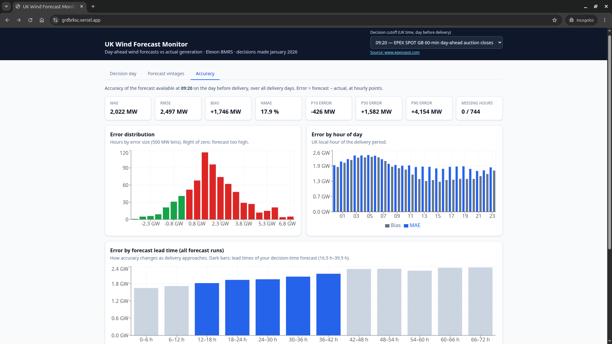

# UK Wind Forecast Monitor

A web app for a UK energy utility's day-ahead trading team. It shows **the wind generation forecast that was actually available when day-ahead purchase decisions were made**, and **measures how accurate that forecast was**, using national wind data from Elexon BMRS for purchase decisions made in January 2026.



| | |
|---|---|
| **Live app** | https://grdbrksc.vercel.app |
| **API docs (interactive)** | https://grdbrksc.vercel.app/api/docs |
| **Video walkthrough** | _link to be added_ |

---

## What it does

The team buys power for delivery day **D** on the morning of **D‑1**, so the forecast that matters is the one that existed at that moment, not the latest one. The user picks a **decision cutoff** (UK time on D‑1). Every view then uses only forecasts published up to that cutoff.

| Tab | Purpose |
|---|---|
| **Decision day** | For a chosen delivery day: the decision-time forecast (hourly) against actual generation (half-hourly), the forecast run used and its lead time, and that day's error figures. |
| **Forecast vintages** | Every forecast run published for that day before it ended, with the decision-time run highlighted. Shows how the forecast changed as delivery approached. |
| **Accuracy** | Error statistics over all 31 delivery days for the chosen cutoff: MAE, RMSE, bias, nMAE, P10/P50/P90; error distribution; error by hour of day; error by forecast lead time; error by day. Clicking a day opens it in the Decision day tab. |

The cutoff dropdown offers 30-minute steps. It also lists the GB day-ahead auction gate closures, each linked to its source:
- **09:20**: EPEX SPOT GB 60-min auction
- **09:50**: Nord Pool N2EX
- **15:30**: EPEX SPOT GB 30-min auction

---

## Quick start

### With Docker (recommended)

```bash
docker compose up --build
```

Open http://localhost:8080. nginx serves the UI and forwards `/api` to the backend container.

### Local development

Requirements: Python 3.12, Node 22.

```bash
# Backend: http://localhost:8000 (docs at /api/docs)
cd backend
python3 -m venv .venv
.venv/bin/pip install -r requirements-dev.txt
.venv/bin/uvicorn app.main:app --reload

# Frontend: http://localhost:5173 (dev server forwards /api to :8000)
cd frontend
npm ci
npm run dev
```

### Checks and tests

These are the same checks CI runs on every push:

```bash
# Backend
cd backend
.venv/bin/ruff check . && .venv/bin/ruff format --check . && .venv/bin/mypy app ingest && .venv/bin/pytest

# Frontend
cd frontend
npm run typecheck && npm run lint && npm run format:check && npm run build
```

### Rebuilding the data snapshot

The app reads a committed snapshot and makes no calls to Elexon at runtime. To download the data again:

```bash
cd backend && .venv/bin/python -m ingest
```

---

## Project structure

```
.
├── backend/
│   ├── app/                      # FastAPI application (what runs in production)
│   │   ├── main.py               # API routes, input validation, caching
│   │   ├── schemas.py            # Pydantic response models (camelCase JSON)
│   │   ├── snapshot.py           # Loads and indexes the JSON snapshot
│   │   ├── alignment.py          # Decision-time forecast selection (core rule)
│   │   ├── metrics.py            # Error metrics and breakdowns
│   │   └── data/                 # Committed snapshot: actuals.json, forecasts.json
│   ├── ingest/                   # Offline only: `python -m ingest`
│   │   ├── elexon.py             # Elexon BMRS client (daily requests, retries)
│   │   └── snapshot.py           # Cleaning (dedupe, latest revision) and JSON writer
│   ├── tests/                    # pytest: unit, API and snapshot-integrity tests
│   ├── pyproject.toml            # Project metadata, ruff/mypy/pytest config
│   ├── requirements.txt          # Pinned runtime dependencies
│   ├── requirements-dev.txt      # Pinned dev/test dependencies
│   ├── .python-version           # Python 3.12
│   └── Dockerfile
├── frontend/
│   ├── src/
│   │   ├── api/                  # Typed API client, response types, fetch hook
│   │   ├── components/           # Cutoff picker, day picker, shared UI
│   │   ├── views/                # Decision day, Forecast vintages, Accuracy
│   │   ├── cutoffs.ts            # Cutoff options and sourced auction times
│   │   ├── format.ts             # UK-time and MW formatting
│   │   └── App.tsx               # Layout, tabs, app state
│   ├── nginx.conf                # Production server config used in Docker
│   ├── Dockerfile                # Multi-stage: Node build, then nginx
│   └── package.json              # Pinned dependencies and scripts
├── docs/screenshot.png
├── docker-compose.yml            # Full stack on localhost:8080
├── vercel.json                   # Vercel Services: frontend at /, backend at /api
└── .github/workflows/ci.yml      # Backend, frontend and Docker jobs
```

---

## Methodology

### Data (Elexon BMRS)
- **Actuals:** `FUELHH` with `fuelType = WIND`. Half-hourly, MW. Where Elexon has republished a corrected value, the latest one is kept.
- **Forecasts:** `WINDFOR`. Hourly, MW. Published 8 times a day, and every run covers the whole of the following day.
- **Scope:** purchase decisions made 1–31 Jan 2026, which means **delivery days 2 Jan – 1 Feb 2026**. Forecast runs published 31 Dec 2025 – 1 Feb 2026 are included, which covers every run that targets those days.
- **Snapshot integrity:** checked by tests. There are no gaps in the actuals, and every forecast run published on D‑1 covers all of day D.

### Core rule
For each hourly target time *t* on delivery day D, with a cutoff C chosen by the user:

```
decision forecast = the WINDFOR value for t with the latest publishTime ≤ (D−1 at C, UK time)
error             = forecast − actual   (MW; positive means the forecast was too high)
lead time         = t − publishTime
```

- **Hourly points only.** Errors are compared at whole hours, where both datasets have values. Nothing is interpolated.
- **Missing hours.** If no forecast was published before the cutoff (possible for cutoffs before about 02:30), the hour is **excluded from all metrics and its count is reported**.
- **UK local days.** Days are handled in Europe/London time, so clock-change days correctly have 23 or 25 hours.
- **Vintages view.** Shows only runs published before the delivery day ended, and only values published before their target time, so nothing shown is information the team could not have had.

### Metrics
| Metric | Definition |
|---|---|
| MAE | Mean absolute error |
| RMSE | Root mean squared error (penalises large misses) |
| Bias | Mean error. Positive means the forecast was systematically too high |
| nMAE | MAE as % of mean actual generation |
| P10 / P50 / P90 | Percentiles of the error distribution |
| Lead-time breakdown | Uses **all** forecast runs in 6-hour bins, to show how accuracy changes as delivery approaches. The bins covering the decision-time forecast are highlighted. |

MAPE is deliberately not used, because it becomes unstable when wind output is low.

---

## Engineering notes

**Design decisions**

| Decision | Why |
|---|---|
| Committed JSON snapshot | The data is historical and fixed. A snapshot is reproducible, starts fast, and doesn't depend on Elexon being available. |
| Plain Python, no pandas | About 18k rows is small. It keeps the serverless bundle small and the logic explicit and easy to test. |
| Binary search per target hour | Forecasts are indexed by target time and sorted by publish time, so finding "latest at or before the cutoff" is O(log n). |
| Vercel Services | A single deployment and domain for the frontend and API, with no CORS. |
| oxlint instead of ESLint | ESLint's TypeScript plugin does not yet support TypeScript 7. oxlint runs with warnings treated as errors. |

**Clean-build standard.** Every change must pass:
- **Backend:** ruff, `mypy --strict` and pytest.
- **Frontend:** strict TypeScript, oxlint (warnings fail the build), Prettier, and a Vite production build with no warnings.
- **Docker:** CI builds and starts the full stack and smoke-tests it through nginx.

**Dependencies** are pinned exactly. `pyproject.toml` and `requirements.txt` are kept identical, and a test enforces this.

---

## Limitations and future work
- **Data scope.** National wind only, from the two datasets in the brief. There is no demand, price, solar or regional data.
- **Comparability.** WINDFOR and FUELHH may not measure exactly the same quantity. For example, metered output reflects wind that grid balancing actions told to turn down (curtailment). The app reports the error as observed and does not adjust for this, because the data that would allow it (Balancing Mechanism actions) is outside the brief's scope.
- **Fixed range.** The snapshot covers January 2026 decisions only. Extending it means running `python -m ingest` with new dates.
- **Possible next steps:**
  - Residual demand (demand minus wind).
  - Probabilistic procurement buffers based on the error distribution.
  - Alerts when the forecast changes sharply between runs.
  - Comparison with other forecast providers.

---

## Development process and use of AI tools

I built this project with **Claude Code** (Anthropic) as an AI pair-programming assistant.

I ran the work as a phased engineering process with a review gate before and after each phase:
1. scaffold and tooling
2. data ingestion
3. core logic and tests
4. API
5. frontend
6. Docker and deployment

At each gate I set the requirements and made the design decisions. These included the cutoff semantics, the delivery-day range, hourly-only comparison, handling of missing hours, which runs the vintages view shows, the data format, the technology stack and the deployment model.

Claude Code sped up the research, implementation, tests and documentation. Examples:
- researching Elexon dataset definitions and auction gate times;
- scaffolding the project;
- drafting code and tests.

I reviewed every change before committing it. I also ran the full lint, type-check, test and build checks at each phase, and verified the results against the raw Elexon data, in Docker, and on the live deployment.
